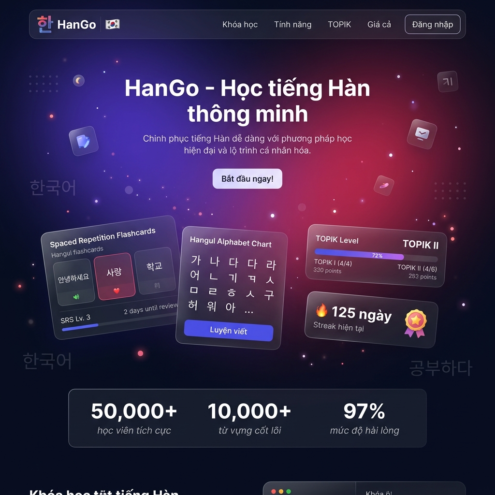
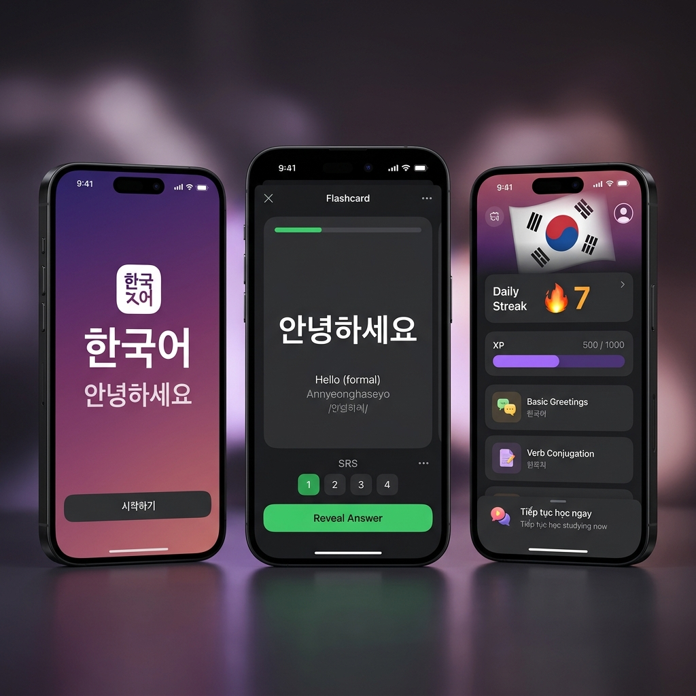

<div align="center">


<br/>

<p align="center">
  <strong>🏆 Nền Tảng Học Tiếng Hàn Hàng Đầu Dành Cho Người Việt</strong><br/>
  <em>Kết hợp Duolingo · Anki · Memrise vào một nền tảng duy nhất, chuẩn TOPIK</em>
</p>

<br/>

<!-- Badges Row 1 -->
<p align="center">
  
  
  
  
</p>

<!-- Badges Row 2 -->
<p align="center">
  
  
  
  
</p>

<!-- Status Badges -->
<p align="center">
  
  
  
  
</p>

<br/>

<p align="center">
  <a href="#-tính-năng">✨ Tính Năng</a> ·
  <a href="#-tech-stack">🛠 Tech Stack</a> ·
  <a href="#-cài-đặt">🚀 Cài đặt</a> ·
  <a href="#-cấu-trúc">📂 Cấu trúc</a> ·
  <a href="#-screenshots">📸 Screenshots</a>
</p>

</div>

---

## 📸 Screenshots

<div align="center">

### 🏠 Trang Chủ — Hero Section


<br/><br/>

### ✨ Tính Năng Nổi Bật — Feature Overview


<br/><br/>

### 📱 Mobile PWA — Trải Nghiệm Trên Điện Thoại


</div>

---

## 🌟 Giới Thiệu

**HanGo** là nền tảng học tiếng Hàn trực tuyến cao cấp được xây dựng đặc biệt cho người Việt Nam, kết hợp những phương pháp học tập tiên tiến nhất thế giới:

| Phương pháp | Nguồn cảm hứng | Điểm nổi bật |
|:-----------:|:--------------:|:-------------|
| 🎮 Gamification | Duolingo | Streak lửa, XP, Huy hiệu, Bảng xếp hạng |
| 🧠 Spaced Repetition | Anki SM-2 | Ôn tập thông minh, nhớ lâu hơn 5× |
| 🎧 Học qua ngữ cảnh | Memrise | Audio thực tế, video bản ngữ |
| 📚 Mẹo nhớ từ Hán-Hàn | Độc quyền | 60%+ từ đồng âm Hán-Việt |
| 🎓 Lộ trình chuẩn | TOPIK Official | 7 cấp độ từ nhập môn đến cao cấp |

---

## ✨ Tính Năng

<details>
<summary><b>🔤 Học Bảng Chữ Cái Hangul</b></summary>

- 10 nguyên âm cơ bản, 14 phụ âm cơ bản, 11 nguyên âm ghép, 5 phụ âm căng đôi
- 7 quy tắc biến âm Patchim chuẩn mực
- Hướng dẫn nét viết từng bước với animation
- Phát âm chuẩn giọng Seoul (IPA + Audio)
- Mini game nhận diện âm thanh
- Bộ theo dõi ký tự hay nhầm lẫn

</details>

<details>
<summary><b>📖 Từ Vựng Thông Minh Hán-Hàn</b></summary>

- 10,000+ từ vựng theo 10 chủ đề sinh hoạt
- Khai thác hơn 60% từ đồng âm Hán-Việt giúp người Việt thuộc từ nhanh gấp đôi
- Tìm kiếm, lọc theo chủ đề, cấp độ
- Lưu yêu thích, ẩn từ, đánh dấu đã học
- Thẻ từ với ví dụ câu thực tế

</details>

<details>
<summary><b>🃏 Flashcard Spaced Repetition (SM-2)</b></summary>

- 4 mức đánh giá: **Quên** · **Khó** · **Tốt** · **Dễ**
- Thuật toán SuperMemo SM-2 tự động tính chu kỳ lặp lại
- 3 chế độ: Hangul→Nghĩa · Nghĩa→Hangul · Typing (gõ câu trả lời)
- Thống kê tiến độ ôn tập theo ngày/tuần/tháng

</details>

<details>
<summary><b>📐 Ngữ Pháp Toàn Diện</b></summary>

- 30+ điểm ngữ pháp trọng yếu: `은/는`, `이/가`, `을/를`, `이에요/예요`, `-고 싶어요`, `-(으)려고 하다`, `-기 때문에`...
- Phân tích công thức, lỗi người Việt hay mắc
- Bài tập áp dụng và quiz tương tác

</details>

<details>
<summary><b>🎧 Luyện Nghe Đa Tốc Độ</b></summary>

- Tốc độ linh hoạt: 0.75× · 1× · 1.25×
- Transcript song ngữ Hàn-Việt
- Chế độ Dictation (nghe chép chính tả)
- Câu hỏi trắc nghiệm sau mỗi bài nghe

</details>

<details>
<summary><b>🎤 Luyện Nói & Chấm Điểm Phát Âm AI</b></summary>

- Nhận diện giọng nói qua Web Speech API
- Chấm điểm **Accuracy** (độ chính xác) & **Fluency** (độ trôi chảy)
- 5 kịch bản đàm thoại: Quán ăn · Mua sắm · Hỏi đường · Phỏng vấn · Giới thiệu bản thân

</details>

<details>
<summary><b>🤖 Gia Sư AI HanGo</b></summary>

- Giải thích ngữ pháp 24/7
- Phân tích và sửa lỗi câu văn tự động
- Nhập vai đàm thoại thực tế
- Hỗ trợ tiếng Việt hoàn toàn

</details>

<details>
<summary><b>🏆 Gamification & Cộng Đồng</b></summary>

- 🔥 Streak lửa hằng ngày
- ⚡ Hệ thống XP & Level
- 🏅 Huy hiệu thành tích
- 📊 Bảng xếp hạng tuần
- 💬 Diễn đàn học viên trao đổi & chia sẻ kinh nghiệm thi TOPIK

</details>

<details>
<summary><b>⚙️ Admin Panel</b></summary>

- Dashboard thống kê học viên & doanh thu (Recharts)
- CRUD toàn bộ: khóa học · từ vựng · ngữ pháp · bài nghe
- Kiểm duyệt báo cáo vi phạm cộng đồng

</details>

---

## 📊 Lộ Trình Học 7 Cấp Độ

```
 Level 0 ──→  Level 1  ──→  Level 2  ──→  Level 3  ──→  Level 4  ──→  Level 5  ──→  Level 6
   📖             🌱            🌿            🌳            🌍            💼            🏆
 Hangul        TOPIK I       TOPIK I       TOPIK II     Giao tiếp    Công sở &     Luyện thi
 Nhập môn      Sơ cấp 1      Nâng cao      Trung cấp    Seoul        Doanh nghiệp  TOPIK II
               (Cấp 1)       (Cấp 2)       (Cấp 3-4)    hằng ngày
```

---

## 🛠 Tech Stack

<div align="center">

| Layer | Technology | Purpose |
|:------|:----------:|:--------|
| **Framework** | Next.js 15 (App Router) | SSR, SSG, API Routes |
| **Language** | TypeScript 5.7+ | Type safety |
| **Styling** | Tailwind CSS 4 + Glassmorphism | UI design system |
| **Icons** | Lucide React | Icon library |
| **State** | Zustand + TanStack Query | Global & server state |
| **Charts** | Recharts | Analytics dashboard |
| **Forms** | React Hook Form + Zod | Validation |
| **Database** | Supabase PostgreSQL | Cloud database |
| **Auth** | Supabase Auth + RLS | Row Level Security |
| **Testing** | Vitest | Unit testing |
| **PWA** | Web App Manifest | Mobile-first |
| **AI** | Web Speech API | Speech recognition |
| **Algorithm** | SuperMemo SM-2 | Spaced repetition |

</div>

---

## 🚀 Cài Đặt

### Yêu cầu hệ thống
- Node.js **18+**
- npm **9+** hoặc pnpm
- Tài khoản [Supabase](https://supabase.com) (miễn phí)

### 1️⃣ Clone Repository

```bash
git clone https://github.com/LoricLocnguyen/hango-korean-platform.git
cd hango-korean-platform
```

### 2️⃣ Cài đặt Dependencies

```bash
npm install --legacy-peer-deps
```

### 3️⃣ Cấu hình Môi trường

```bash
cp .env.example .env.local
```

Mở `.env.local` và điền thông tin Supabase:

```env
NEXT_PUBLIC_SUPABASE_URL=your_supabase_project_url
NEXT_PUBLIC_SUPABASE_ANON_KEY=your_supabase_anon_key
SUPABASE_SERVICE_ROLE_KEY=your_service_role_key
```

### 4️⃣ Khởi chạy Database (Supabase)

```bash
# Chạy migrations trong Supabase SQL Editor
# Xem file: supabase/migrations/
```

### 5️⃣ Chạy Development Server

```bash
npm run dev
```

Mở trình duyệt tại: **[http://localhost:3000](http://localhost:3000)** 🎉

---

## 📂 Cấu Trúc Thư Mục

```
hango/
├── 📁 app/                       # Next.js 15 App Router
│   ├── 🏠 page.tsx               # Landing Page
│   ├── 📊 dashboard/             # Dashboard học tập
│   ├── 🗺 learn/                  # Lộ trình 7 cấp độ
│   ├── 🔤 hangul/                # Học bảng chữ cái Hangul
│   ├── 📖 vocabulary/            # Từ vựng & chi tiết từ
│   ├── 🃏 flashcards/            # Flashcard SRS (SM-2)
│   ├── 📐 grammar/               # Cẩm nang ngữ pháp
│   ├── 🎧 listening/             # Luyện nghe đa tốc độ
│   ├── 🎤 speaking/              # Luyện nói & Chấm điểm AI
│   ├── 📝 practice/              # Quiz Engine
│   ├── 📱 lesson/[id]/           # Trình phát bài học đa khối
│   ├── 🤖 ai-tutor/              # Gia sư AI HanGo
│   ├── 💬 community/             # Diễn đàn học viên
│   ├── 🏅 achievements/          # Huy hiệu thành tích
│   ├── 🏆 leaderboard/           # Bảng xếp hạng tuần
│   ├── 👤 profile/               # Hồ sơ cá nhân
│   ├── ⚙️  settings/             # Cài đặt tài khoản
│   ├── 🔐 admin/                 # Quản trị viên
│   └── 🔑 (auth)/                # Login · Register · Forgot PW · Onboarding
│
├── 📁 components/                # Reusable UI Components
│   ├── landing/                  # Landing page sections
│   ├── ui/                       # Base UI components
│   └── [feature]/                # Feature-specific components
│
├── 📁 lib/                       # Utilities & Business Logic
│   ├── types/                    # TypeScript type definitions
│   ├── algorithms/               # SM-2 Spaced Repetition
│   ├── seed/                     # Seed data for development
│   └── utils/                    # Helper functions
│
├── 📁 supabase/
│   └── migrations/               # SQL Schema DDL & RLS Policies
│
├── 📁 public/                    # Static assets & PWA manifest
├── 📁 docs/screenshots/          # Project screenshots
└── ⚙️  config files              # next.config, tailwind, tsconfig...
```

---

## 🧪 Testing

```bash
# Unit tests
npm test

# Test với coverage
npm run test:coverage

# Build kiểm tra production
npm run build
```

---

## 🤝 Đóng Góp

Chúng tôi luôn chào đón mọi đóng góp! 🙌

```bash
# Fork repository
# Tạo feature branch
git checkout -b feat/amazing-feature

# Commit changes
git commit -m "feat: add amazing feature"

# Push branch
git push origin feat/amazing-feature

# Tạo Pull Request
```

---

## 📜 Giấy Phép

Dự án được phân phối dưới **MIT License**.  
Xem file [LICENSE](LICENSE) để biết thêm chi tiết.

---

<div align="center">

### ⭐ Nếu dự án hữu ích, hãy cho chúng tôi một Star! ⭐

<br/>


<br/>

Made with ❤️ in Vietnam 🇻🇳 · Powered by HanGo Team

<br/>

<a href="https://github.com/LoricLocnguyen/hango-korean-platform/stargazers">
  
</a>
&nbsp;
<a href="https://github.com/LoricLocnguyen/hango-korean-platform/network/members">
  
</a>
&nbsp;
<a href="https://github.com/LoricLocnguyen/hango-korean-platform/issues">
  
</a>

</div>
